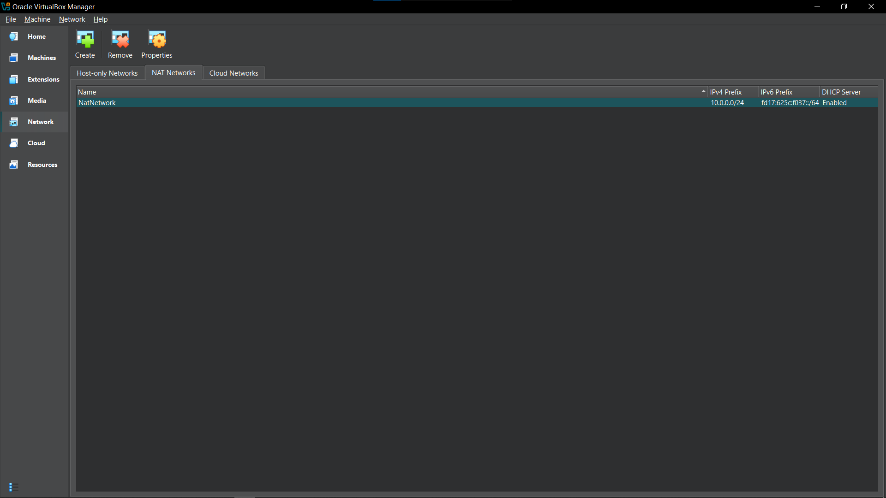
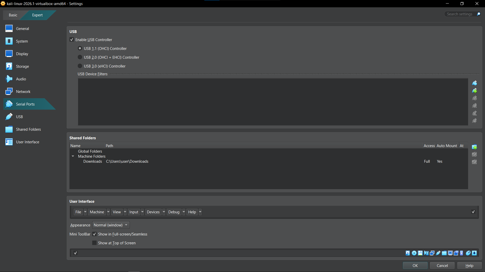
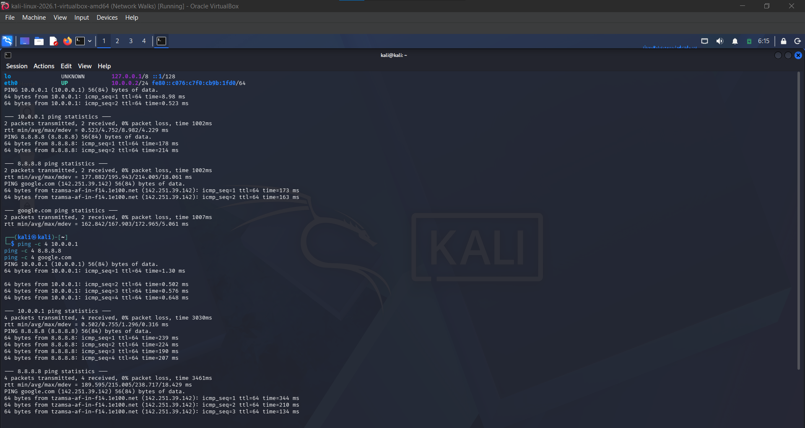

# Cybersecurity Testing Lab Setup (WK1-PM1)

## 1. Objective

Build an isolated cybersecurity practice lab on a personal laptop using VirtualBox, with Kali Linux as the attacker machine on a custom NAT network.

| Requirement | Target |
|---|---|
| Hypervisor | VirtualBox (latest recommended version) |
| Attacker VM | Kali Linux |
| Network | NATNetwork, 10.0.0.0/24 |
| Kali IP | 10.0.0.2/24 |
| Internet | Full access from Kali |
| Clipboard and drag/drop | Enabled |
| Shared folder | Host Downloads folder |

## 2. Environment

| Item | Value |
|---|---|
| Host OS | Windows 10 Pro |
| Host RAM | 8 GB (2400 MHz) |
| Host CPU | Intel Core i5-7200U @ 2.50 GHz |
| VirtualBox version | 7.2.8 r173730 |
| Kali image | kali-linux-2026.1-virtualbox-amd64 |
| Guest OS type | Debian (64-bit) |
| VM memory | 2048 MB |
| VM processors | 2 |
| VM disk | 80.09 GB (VDI) |
| Graphics controller | VMSVGA, 128 MB video memory |
| Network adapter | Adapter 1, Intel PRO/1000 MT Desktop, NAT Network 'NatNetwork' |

## 3. Setup Steps

### Step 1: Install 7-Zip
Installed 7-Zip to extract the Kali VM archive.

### Step 2: Install VirtualBox
Downloaded and installed VirtualBox from the official downloads page.

### Step 3: Create the NATNetwork
Tools > Network > NAT Networks > Create. Name: `NatNetwork`, IPv4 prefix: `10.0.0.0/24`, DHCP enabled.



### Step 4: Import Kali Linux
Downloaded the prebuilt Kali VirtualBox image from kali.org/get-kali, extracted it with 7-Zip and added the `.vbox` file to VirtualBox.

### Step 5: Attach Kali to the NATNetwork
Settings > Network > Adapter 1 > Attached to: NAT Network > Name: NatNetwork.

### Step 6: Clipboard and drag/drop
Settings > General > Features. Shared Clipboard: Bidirectional. Drag-and-Drop: Bidirectional.

### Step 7: Shared folder
Settings > Shared Folders > added the host Downloads folder with Auto-mount and Make Machine-permanent enabled. It mounts in Kali at `/media/sf_Downloads` (read/write).



### Step 8: Static IP on Kali
Network icon > Edit Connections > Wired connection 1 > IPv4 Settings.

| Field | Value |
|---|---|
| Method | Manual |
| Address | 10.0.0.2 |
| Netmask | 24 |
| Gateway | 10.0.0.1 |
| DNS | 8.8.8.8 |

### Step 9: Snapshot
Took a snapshot named `Network Walks` (description: First assignment setup) on 30 October 2026 at 10:38 PM, so the lab can be restored at any time.

## 4. Verification

Commands run inside Kali:

```bash
ip -br a
ping -c 2 10.0.0.1
ping -c 2 8.8.8.8
ping -c 2 google.com
```



| Check | Result | Evidence |
|---|---|---|
| Kali has 10.0.0.2/24 on eth0 | Pass | `eth0 UP 10.0.0.2/24` |
| Gateway 10.0.0.1 reachable | Pass | 2/2 replies, 0% loss |
| Internet by IP (8.8.8.8) | Pass | 2/2 replies, 0% loss |
| DNS resolution (google.com) | Pass | Resolved to 142.250.27.100, 2/2 replies, 0% loss |
| Clipboard and drag/drop | Configured | Shared Clipboard and Drag-and-Drop both set to Bidirectional |
| Shared folder visible in Kali | Pass | `mount` shows `Downloads on /media/sf_Downloads type vboxsf (rw,nodev,relatime)` |
| Snapshot taken | Pass | Snapshot `Network Walks` listed in the Snapshots tab |

## 5. Issues Faced and Fixes

| Issue | Cause | Fix |
|---|---|---|
| `eth0` was up but had no IPv4 address, so there was no 10.0.0.2/24 | The static IPv4 configuration had not been applied to the connection | Applied the manual IPv4 settings (10.0.0.2/24, gateway 10.0.0.1, DNS 8.8.8.8) and restarted the connection. `ip -br a` then showed 10.0.0.2/24 |
| Shared folder path rejected, OK button greyed out in Add Share | A typo in the Windows folder path (an extra character) | Corrected the path to the real Downloads folder using the browse option, and set the folder name to `Downloads` |
| `ping: usage error: Destination address required` | Ran `ping -c 4` without a target address | Re-ran the command with the target, for example `ping -c 4 10.0.0.1` |

Known fix for no internet on VirtualBox 7 with Kali 2026.1 or newer (from the course material):

```bash
sudo nmcli connection modify "Wired connection 1" ipv4.dad-timeout 0
sudo nmcli connection down "Wired connection 1"
sudo nmcli connection up "Wired connection 1"
```

## 6. Lessons Learned

- A NAT Network keeps lab machines isolated from the home network but still gives them internet, which is the safe default for attack practice.
- An interface that shows UP does not mean it has an address. Always confirm with `ip -br a`.
- Static IPs make the lab predictable. Two VMs sharing 10.0.0.2 will break connectivity for both.
- Testing in layers (gateway, then IP, then DNS) shows exactly where a connection fails.
- Duplicate address detection can delay or block the connection on newer Kali and VirtualBox versions, so check `nmcli` settings early.
- Snapshots turn mistakes into a one-click rollback. Take one before every risky change.

## 7. Next Steps

Add Windows 10/11 VMs on the same NATNetwork (10.0.0.10, 10.0.0.11), ping test between machines and start practising scanning and enumeration only inside this lab.

## 8. Repository Structure

```
.
├── README.md
└── screenshots/
    ├── 01-natnetwork.png
    ├── 02-verification.png
    └── 03-shared-folder.png
```

## 9. Disclaimer

This lab is for learning and ethical practice only, on systems I own or am authorised to test.
